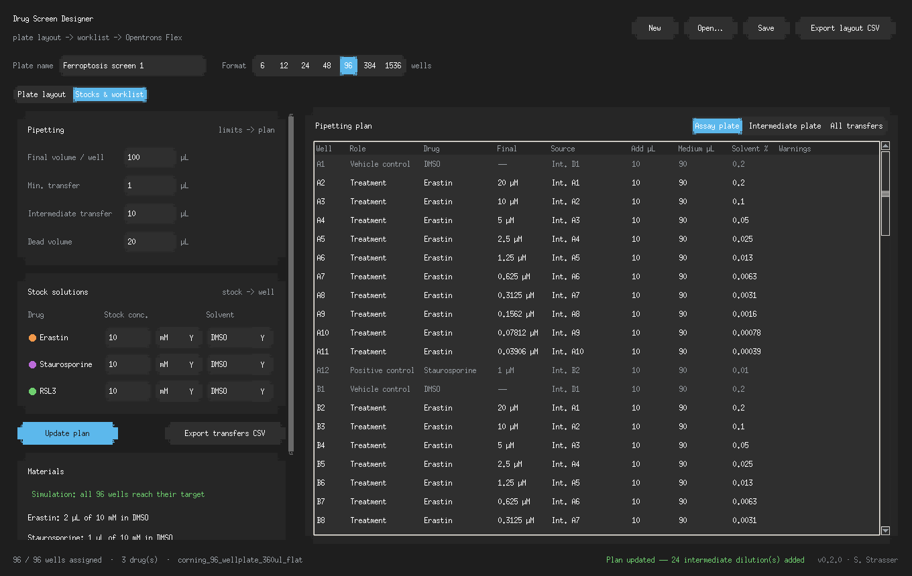
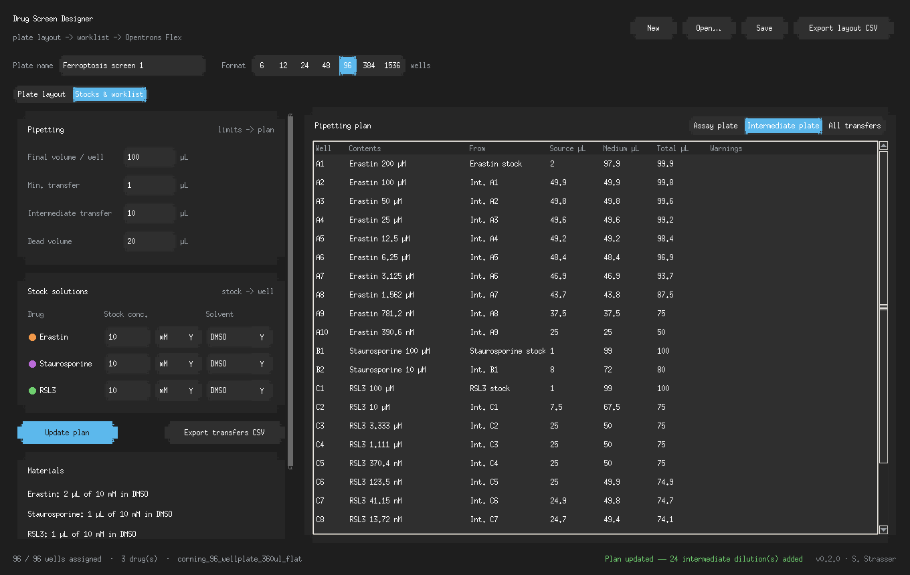

# Drug Screen Designer

Design drug screening plates and generate the pipetting worklist for an
end-to-end screen on the Opentrons Flex. Built for the Physical AI for
Science Hack (San Francisco, Oct 2026), open track.

Shares its look and core calculation code with the
[Drug Concentration Calculator](https://github.com/steffiAI/drug-dosage-calculator).


## Features (v0.2.0)

- **Plate formats**: 6, 12, 24, 48, 96, 384 and 1536 wells
- **Well selection**: click, drag a rectangle, click/drag row or column labels,
  corner = select all, Ctrl/Shift to add or remove wells
- **Assign wells**: drug, final concentration (M/mM/µM/nM) and role
  (treatment, vehicle control, positive control, untreated)
- **Dose series**: fill a selection with a serial dilution, along rows or down columns
- **Plate map**: color = drug, brightness = log concentration, ring = positive control
- **Pipetting plan**: per-drug stock concentration and solvent; the planner works out
  stock volumes (C1·V1 = C2·V2) and adds **intermediate dilutions** automatically when a
  direct transfer would be below the minimum pipetting volume (configurable, default
  1 µL for the Flex 50 µL pipette in low-volume mode). Dose series become serial
  dilutions on a 96 deep-well intermediate plate; very concentrated stocks get
  pre-dilution steps. Vehicle controls are matched to the highest solvent percentage
  of the treated wells, and DMSO above 0.5% is flagged
- **Transfer list**: every robot step in order (medium into the intermediate plate,
  intermediate preparation, dosing of the assay plate), exportable as CSV for the
  Opentrons protocol
- **Simulation check**: every plan is replayed transfer by transfer, independently of the
  planner, and each well is compared with the layout (concentration, volume, solvent %,
  no well aspirated dry, every transfer ≥ the minimum). Shown in the app after
  "Update plan" and available as `scripts/verify_plan.py`
- **Files**: save/open layouts as JSON (including stocks and pipetting settings),
  export the layout and the transfer list as CSV





## Requirements

- Python 3.11+
- Package manager: uv

## Installation

```bash
git clone <repo-url>
cd drug-screen-platform
uv sync
uv run python main.py
```

## Checking the plan

```bash
uv run pytest                                      # unit tests + 300 random plate layouts
uv run python scripts/verify_plan.py               # simulate the built-in example plate
uv run python scripts/verify_plan.py plate.json    # simulate a layout saved from the app
uv run python scripts/verify_plan.py plate.json --min-transfer 5 --all
```

## Project structure

```
drug-screen-platform/
├── main.py                # GUI (CustomTkinter)
├── src/
│   ├── plate_formats.py   # plate geometry, well naming, Opentrons labware names
│   ├── plate_layout.py    # layout model, dose series, JSON/CSV
│   ├── dilution_planner.py # intermediate dilutions and ordered transfer list
│   ├── plan_checker.py    # replays the transfers and checks every well
│   ├── plate_canvas.py    # interactive plate widget
│   ├── ui_helpers.py      # theme tokens and window helpers
│   ├── calculators.py     # from Drug Concentration Calculator
│   ├── formatters.py      # from Drug Concentration Calculator
│   └── font_manager.py    # from Drug Concentration Calculator
├── scripts/
│   └── verify_plan.py     # command-line plan check
├── tests/
└── assets/
```

## Roadmap

- Opentrons Flex protocol generation from the transfer list (Python API, `opentrons.protocol_api`), tested in the Opentrons simulator
- Randomized / edge-avoiding layouts
- PubChem molecular weight lookup for stock preparation

## License

MIT License
